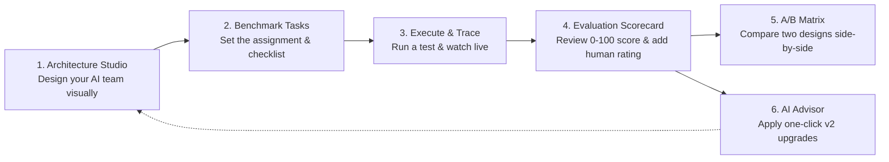

# HarnessForge — Non-Technical User Manual

> **Who this guide is for:** Business Analysts, Product Managers, Management Consultants, and Team Leads who want to **design, test, and improve AI agent teams visually** — without writing code or editing configuration files.
>
> *Looking for YAML schemas, CLI commands, or developer internals? See the [Technical User Guide](USER_GUIDE.md).*

---

## Table of Contents
1. [The 30-Second Mental Model: Your AI Team = A Consulting Firm](#1-the-30-second-mental-model-your-ai-team--a-consulting-firm)
2. [Opening HarnessForge Studio](#2-opening-harnessforge-studio)
3. [Tab 1 — Architecture Studio (Design Your AI Team)](#3-tab-1--architecture-studio-design-your-ai-team)
4. [Tab 2 — Benchmark Tasks (Define the Assignment & Grading Checklist)](#4-tab-2--benchmark-tasks-define-the-assignment--grading-checklist)
5. [Tab 3 — Execute & Trace (Run a Test & Watch Your Team Work)](#5-tab-3--execute--trace-run-a-test--watch-your-team-work)
6. [Tab 4 — Evaluation Scorecard (Read the Results & Add Your Grade)](#6-tab-4--evaluation-scorecard-read-the-results--add-your-grade)
7. [Tab 5 — A/B Matrix (Compare Two Designs Side-by-Side)](#7-tab-5--ab-matrix-compare-two-designs-side-by-side)
8. [Tab 6 — AI Advisor (One-Click Team Improvements)](#8-tab-6--ai-advisor-one-click-team-improvements)
9. [10-Minute Worked Example: Technical Business Analyst Team](#9-10-minute-worked-example-technical-business-analyst-team)
10. [Copy-Paste Prompt Playbook by Harness (Claude Code, Antigravity & OpenCode)](#10-copy-paste-prompt-playbook-by-harness-claude-code-antigravity--opencode)
11. [Working with IT (Optional Enterprise Setup)](#11-working-with-it-optional-enterprise-setup)
12. [Common Mistakes & Quick Fixes (FAQ)](#12-common-mistakes--quick-fixes-faq)
13. [A–Z Jargon-to-English Glossary](#13-az-jargon-to-english-glossary)

---

## 1. The 30-Second Mental Model: Your AI Team = A Consulting Firm

Instead of giving one giant prompt to a single AI chatbot and hoping for the best, **HarnessForge** lets you design a **team of AI specialists** with clear roles, checklists, and quality gates — just like organizing a real project team.

| HarnessForge Term | Real-World Analogy | What It Does |
| :--- | :--- | :--- |
| **Blueprint** | Your Team Org Chart & SOP | The saved design of your entire AI team, its workflow, and its rules. |
| **Root Orchestrator** | Engagement Manager / Project Lead | Receives the goal, delegates work to specialists in order, and reviews results. |
| **Subagent** | Specialist Team Member | A focused role (e.g., *Requirements Analyst*, *Workflow Architect*, *QA Reviewer*). |
| **Workflow Handoff Edge** | Project Process Step (`#1 → #2 → #3`) | Defines who hands off work to whom, in what order, and whether retries are allowed. |
| **Skill** | Reusable Playbook / Template | A domain guide or checklist (e.g., *User Story Standard*, *API Design*) assigned to specific specialists. |
| **Guardrail Hook** | Compliance / Safety Rule | An automatic rule (e.g., *"The Manager cannot bypass QA sign-off"*). |
| **MCP Server** | External App Connection | A connector giving selected specialists access to external tools (Jira, GitHub, Figma, Databases). |
| **Harness** | The AI Software Running Your Team | The underlying AI platform you deploy to (**Claude Code**, **Antigravity**, or **OpenCode**). |
| **Benchmark Task** | Practice Assignment + Grading Rubric | A repeatable test scenario with automatic pass/fail checks to measure how well your team performs. |

### The 6-Tab Workflow at a Glance



---

## 2. Opening HarnessForge Studio

1. On Windows, double-click **`start_studio.bat`** in the HarnessForge folder (or ask your IT/setup contact to start the Studio for you).
2. Open your web browser and go to **`http://localhost:5173`**.

### Top Navigation Bar
Across the top of the screen you will always see:
- **6 Workflow Tabs** (`1. Architecture Studio` through `6. AI Advisor (v2 Diff)`).
- **Target Harness Selector** (`Claude Code`, `Antigravity (AGY)`, or `OpenCode`) — chooses which AI platform you are previewing or testing against.
- **`Deploy & Evaluate` Button** — a quick shortcut to run your currently selected team on your currently selected Benchmark Task.

---

## 3. Tab 1 — Architecture Studio (Design Your AI Team)

This is your visual whiteboard. Everything you change on the canvas **auto-saves automatically** (look for the green **`Saved`** badge in the top toolbar — you never need to edit raw YAML!).

### 3.1 Pick a Blueprint or Create Your Own
- In the **left sidebar**, click any starter blueprint — for example, **Technical Business Analyst** (`technical-business-analyst`).
- Want to experiment safely without changing the original? Click **`Clone`** (or **`+ New`**) to create your own editable copy.
- You can rename a blueprint anytime using the pencil icon, or remove an unused custom blueprint with the trash icon.

### 3.2 Understanding the 5 Card Colors on the Canvas
Each box on the visual canvas represents one building block of your AI team:

| Card Color | Card Type | Example |
| :--- | :--- | :--- |
| **Indigo** | **Root Orchestrator** | *Lead Technical Business Analyst* (coordinates everyone else) |
| **Cyan** | **Subagent (Specialist)** | *Requirements Elicitor*, *Workflow Architect*, *User Story Author*, *QA Gatekeeper* |
| **Emerald** | **Skill / Playbook** | *User Story Template (3Cs + INVEST)*, *Delivery & RTM Checklist* |
| **Amber** | **Guardrail Hook** | *Prevent Lead from writing specs directly without specialists* |
| **Purple** | **MCP Server (External Tool)** | *GitHub*, *Figma*, *Postgres*, *Atlassian* |

> **Tip:** Drag cards anywhere on the canvas to arrange your diagram neatly. Your layout positions save automatically.

### 3.3 Editing Any Team Member (Right-Hand Inspector Panel)
Click any card on the canvas to open its settings in the right-hand **Inspector** panel:
- **Name & ID**: Give each specialist a clear title (renaming an ID automatically updates all connected arrows and rules).
- **Role & System Prompt**: Write in plain English what this specialist is responsible for, what they should produce, and what they must *not* do.
- **Model Tier (Smartness vs. Speed/Cost)**:
  - `reasoning` — Best for deep analysis, discovery, and planning (e.g., *Requirements Elicitor*).
  - `coding` — Best for writing detailed documents, workflows, or code (e.g., *User Story Author*).
  - `fast` — Fast and low-cost for checklists and QA reviews (e.g., *BA QA Gatekeeper*).
  - `default` — Balanced general coordinator (great for the *Root Orchestrator*).
- **Permissions**:
  - **Write: ON / Read-Only** — Decide whether this specialist is allowed to create/edit files or only read and review.
  - **Shell: ON / No Shell** — Decide whether this specialist can run terminal commands (for pure document/BA teams, you can leave Shell **OFF**).
- **Assigned MCP Servers**: Check the boxes for any external tools this specialist is allowed to use (least-privilege access).

### 3.4 Connecting Workflow Steps & Skills on the Canvas
To connect two cards, **drag from the small dot at the bottom of one card to the dot at the top of another card**:

1. **Agent → Agent = Workflow Handoff Edge** (Animated blue/amber arrows):
   - Defines the exact sequence your team follows (`#1`, `#2`, `#3`…).
   - In the **Inspector → Workflow Handoff Edges** section, you can:
     - Click **`↑` / `↓`** to reorder steps.
     - Click **`Required`** / **`Conditional`** to mark whether a step is mandatory or only happens on a condition (like a QA retry loop).
     - Set the retry limit (**`≤1x`**, **`≤3x`**, etc.) so a QA critic can send work back for revision up to 3 times.
     - Edit the trigger description in plain English (e.g., *"If VERDICT == FAIL, return to User Story Author"*).
2. **Agent ↔ Skill = Skill Assignment** (Dashed green arrows):
   - Drag between any Agent/Subagent and any Skill (in **either** direction — HarnessForge automatically points it cleanly from Agent → Skill!).
   - In the **Inspector → Skill Assignments** section, all assigned skills are **grouped and sorted alphabetically by `@agent_id`** so you can see at a glance which playbooks each specialist uses.
3. **Hook → Agent = Guardrail Binding** (Dashed amber arrows):
   - Drag from a Guardrail Hook to an Agent to enforce that rule on that agent (or select `All Agents (*)` in the Hook Inspector).
4. **Deleting a Card or Arrow**:
   - Click any card or arrow and press **`Delete` / `Backspace`** on your keyboard, or click the **Trash** icon in the Inspector.

---

## 4. Tab 2 — Benchmark Tasks (Define the Assignment & Grading Checklist)

A **Benchmark Task** is a repeatable test case you use to measure how well your AI team performs. Instead of eyeballing outputs manually every time, you define the assignment and a **grading checklist (Deterministic Outcome Verifiers)** once, and reuse it to grade every run objectively.

### 4.1 Using Built-In Tasks or Creating a New One
- Browse existing tasks on the left (for example: **`FocusFlow To-Do Application — Full Technical BA Discovery & Delivery Pack`**).
- To design a brand-new evaluation task for your own business workflow:
  1. Click **`+ New Task`**.
  2. Pick a starter template that matches your domain:
     - **Business Analysis** (Workflows, User Stories, RTM, Mermaid diagrams)
     - **Product Management** (PRDs, Meeting Summaries, Decision Logs)
     - **Frontend / UI** (Web screens, accessibility, component checks)
     - **Feature / Engineering** (Code + automated test suites)
     - **Custom** (Start from a clean slate)
  3. Fill in the **Task Name**, **Prompt** (the brief you give the AI team), and **Workspace Source** (the folder containing your input notes/files).
  4. Click **`Save Task`**.

### 4.2 Customizing the Grading Checklist (Deterministic Outcome Verifiers)
In Tab 2, you can **Add, Edit, or Delete** automatic pass/fail checks without writing code:

| Verifier Type | Plain-English Meaning | Example Use |
| :--- | :--- | :--- |
| **File Exists** | Checks that a required deliverable file was created. | Confirm `EPICS_AND_USER_STORIES.md` exists. |
| **Markdown Sections Present** | Checks that required headings appear in a document. | Verify `Executive Summary`, `Decisions`, `Action Items` are all present. |
| **User Story INVEST & 3Cs Check** | Checks that User Stories follow Connextra (`As a… I want… so that…`), 3 Cs (`Card`, `Conversation`, `Confirmation`), `Given/When/Then` QA scenarios, and `INVEST`. | Audit BA delivery packs automatically. |
| **Mermaid Diagram Check** | Checks that required visual diagrams (`flowchart`, `sequenceDiagram`, `stateDiagram`) exist and have valid syntax. | Verify `WORKFLOWS_AND_DELIVERY_DOCS.md`. |
| **Regex / Keyword Match** | Checks that specific IDs or business rules appear in the output. | Confirm `BR-001` through `BR-010` are traceable in the RTM. |
| **Command Exit Code** | *(Technical)* Runs a script or test command and checks if it passes. | Run `pytest` on a software project. |

For each verifier, you can set:
- **Weight** (e.g., `1.0` to `3.0`) — how much it counts toward the 0–100 score.
- **Required** — if checked, failing this check flags the overall run as not meeting minimum acceptance criteria.

---

## 5. Tab 3 — Execute & Trace (Run a Test & Watch Your Team Work)

Once your team (Tab 1) and assignment (Tab 2) are ready, switch to **3. Execute & Trace** to run an evaluation and watch every step live.

### 5.1 Choose an Execution Mode
- **Simulated Sandbox Benchmark *(Best for fast design testing)***: Runs a fast (~5 second) end-to-end simulation of your workflow topology and verifies your handoffs, guardrails, and scorecard — **no paid API key or external CLI required**.
- **Headless Automated Harness CLI**: Launches the real AI tool (`Claude Code`, `Antigravity`, or `OpenCode`) automatically in an isolated copy of the workspace and grades the real outputs.
- **Interactive User Session**: Prepares an isolated workspace so you can open your AI tool, work interactively, and click **`Complete & Evaluate Interactive Session`** when finished.

### 5.2 Check the Pre-Flight Checks Panel
Before you click **`Start Execution Run`**, look at the **Pre-Flight Checks** box right above the button:
- **Green Checkmark (`Pass`)**: Ready to go.
- **Amber Triangle (`Warn`)**: Non-blocking heads-up (for example, *"CLI not installed — will use Simulator"* or *"Stale evaluations found in history"*).
- **Red X (`Fail`)**: Must be fixed before running (for example, missing input folder or another evaluation already running). Click **`Re-check`** after fixing.

### 5.3 Blocking Execution & Live Monitoring
- **One evaluation at a time**: When you click **`Start Execution Run`**, HarnessForge locks the launch controls and displays an amber **`Blocking Evaluation In Progress`** banner. This prevents accidental double-clicks or overlapping runs from corrupting results.
- Want to end a long-running test early? Click **`Stop & Evaluate Now`** — HarnessForge stops the run and grades whatever deliverables have been produced so far.
- Watch the live feed on the right in two views:
  - **Structured Timeline**: Clean step-by-step cards showing which `@agent` acted, what tool it used, time taken, and token cost.
  - **Plain-Text Log (`execution.log`)**: A readable transcript you can copy with one click (**`Copy Log for Feedback`**).

### 5.4 Keeping Execution History Clean
In the left **Execution History** list:
- Click **`Clear Stale`** anytime to automatically remove interrupted, cancelled, or orphaned runs (marked with an amber **`STALE`** badge) while keeping all your valid completed evaluations intact.
- Click the **Trash** icon on an individual run to remove just that run, or **`Clear All`** to wipe the entire history.

---

## 6. Tab 4 — Evaluation Scorecard (Read the Results & Add Your Grade)

Click **`View Full Evaluation`** (or switch to **Tab 4**) to see your team's report card on a **0–100 scale**:

1. **Overall Composite Score (0–100)**: Combines deliverable completeness, workflow efficiency, and quality into one headline number.
2. **Layer 1 — Deterministic Outcome Verifiers**: A clear Pass/Fail checklist showing every grading rule from Tab 2 (e.g., *All 5 Business Requirements traced*, *Mermaid diagrams valid*, *User Stories pass 3Cs & INVEST*).
3. **Layer 2 — Trajectory & Per-Agent Resource Breakdown**:
   - **Topology Adherence (%)**: Did your team follow the planned handoff steps, or did someone skip a step or get blocked by a guardrail?
   - **Per-Node Breakdown Table**: Shows every specialist's invocations, time share (%), token share (%), and estimated cost (`$`). Great for spotting bottlenecks!
4. **Layer 3 — Qualitative AI Judge + Your Human Rating**:
   - Read the AI Judge's executive summary, strengths, and weaknesses.
   - Add your own **1–5 Star Human Rating** and written review notes (e.g., *"Acceptance criteria were sharp, but edge cases on recurring dates were thin"*) and click **`Save Human Grade`**.

---

## 7. Tab 5 — A/B Matrix (Compare Two Designs Side-by-Side)

Not sure whether a **4-specialist BA team** outperforms a **single generalist AI**, or whether **Antigravity** outperforms **OpenCode** on your workflow?

1. Open **Tab 5 (`5. A/B Matrix`)**.
2. Check the boxes next to **2 or more completed runs** you want to compare.
3. Click **`Run Side-by-Side Comparison`**.
4. Review:
   - **Winner Banner**: Highlights the highest-scoring run.
   - **Comparison Matrix**: Side-by-side table of Overall Score, Verifier Pass Rate, Workflow Adherence, Total Cost (`$`), and Execution Time.
   - **Key Takeaways**: Plain-English bullet summary of the trade-offs (e.g., *"Team B scored +24 points higher on quality at only +$0.04 extra cost"*).

---

## 8. Tab 6 — AI Advisor (One-Click Team Improvements)

When a run scores lower than you want, **Tab 6 (`6. AI Advisor`)** acts as an automated coach:

1. Select a completed run and open **Tab 6**.
2. Review the **Diagnoses** (color-coded as `Critical`, `Warning`, or `Optimization`) — for example:
   - *"Specialist `user_story_author` skipped boundary test cases — add explicit BDD confirmation rule."*
   - *"QA Gatekeeper is using an expensive reasoning model — switch to `fast` tier to cut latency by 55%."*
3. Review the proposed changes and click **`Save as New v2 Blueprint`** (recommended — keeps your `v1` safe so you can A/B test `v1` vs `v2` in Tab 5!).

---

## 9. 10-Minute Worked Example: Technical Business Analyst Team

Follow this quick walkthrough to experience the full loop from start to finish:

1. **Inspect the Team (Tab 1)**:
   - Select **`Technical Business Analyst`** (`technical-business-analyst`) in the left sidebar.
   - Look at the 4-stage pipeline on the canvas:
     `Lead TBA (Orchestrator)` → `requirements_elicitor` → `workflow_architect` → `user_story_author` → `ba_qa_gatekeeper` (with a `≤3x` revision loop back to `user_story_author`).
   - Click `user_story_author` and notice in the Inspector: **Model** = `coding`, **Write** = `ON`, and **Skill Assignments** shows `/wikipedia-user-story`.
2. **Review the Assignment (Tab 2)**:
   - Select **`FocusFlow To-Do Application — Full Technical BA Discovery & Delivery Pack`**.
   - Check the verifiers: it grades both `WORKFLOWS_AND_DELIVERY_DOCS.md` (Mermaid diagrams + Data Dictionary) and `EPICS_AND_USER_STORIES.md` (Connextra + 3 Cs + INVEST + RTM).
3. **Run a Fast Benchmark (Tab 3)**:
   - Confirm **Execution Mode** is **`Simulated Sandbox Benchmark`**.
   - Verify **Pre-Flight Checks** shows a green **`READY`** badge.
   - Click **`Start Execution Run`** and watch the 4 specialists hand off work in real time.
4. **Inspect the Scorecard (Tab 4)**:
   - Click **`View Full Evaluation`**.
   - Check the **Deterministic Outcome Verifiers** (100% pass), **Per-Agent Breakdown**, and add your own 5-star Human Rating.
5. **Compare Against a Solo AI (Tabs 1, 3 & 5)**:
   - Run the same task with the **`Solo Generalist`** blueprint, then open **Tab 5 (`A/B Matrix`)** and compare both runs side-by-side to see how the structured 4-specialist team improves completeness and governance.

---

## 10. Copy-Paste Prompt Playbook by Harness (Claude Code, Antigravity & OpenCode)

Once your AI team is deployed into a project folder (via **Tab 1 → `Compiled Files` → `1. Deploy & Link Docs`**), you interact with it inside your chosen AI application (**Claude Code**, **Antigravity**, or **OpenCode**).

Because each harness uses slightly different shorthand for **Workflows**, **Skills**, **MCP Tools**, and **Custom Commands**, use the quick-reference table and copy-paste playbooks below.

### 10.1 Quick-Reference Comparison Across All 3 Harnesses

| What You Want to Do | Claude Code (`claude`) | Antigravity (`agy` / IDE) | OpenCode (`opencode`) |
| :--- | :--- | :--- | :--- |
| **Verify setup & docs** | `/verify-setup` | *"Run the `verify-setup` skill."* | `/verify-setup` |
| **Run full multi-agent workflow** | Ask the Lead Orchestrator in plain English (follows `CLAUDE.md`) | *"Follow `GEMINI.md` and run the full multi-agent workflow..."* | Ask primary orchestrator (follows `AGENTS.md`) or run `/generate-tba-pack` |
| **Call one specific specialist** | *"Delegate to the `<subagent_id>` subagent to..."* | *"Invoke the `<subagent_id>` subagent to..."* | `@<subagent_id> ...` (or press `Tab` to switch agents) |
| **Apply a Skill / Playbook** | `/<skill-slug>` or *"Use the `<skill-slug>` skill..."* | *"Use the `<skill-slug>` skill to..."* | `/<skill-slug>` or *"Apply `/<skill-slug>`..."* |
| **Use an MCP Server tool** | *"Use the `<mcp_server>` MCP server to..."* | *"Using the `<mcp_server>` MCP server, ..."* | *"`@<subagent_id>` use `<mcp_server>` MCP to..."* |
| **Run a Custom Command** | `/<command-id>` | *"Run the `<command-id>` skill."* | `/<command-id>` |
| **Prepare for Studio scoring** | `/evaluate-project` | *"Run the `evaluate-project` skill."* | `/evaluate-project` |

---

### 10.2 Generic Reusable Prompt Templates (Any Blueprint)

Swap `<subagent_id>`, `<skill-slug>`, `<mcp_server>`, and `<command-id>` with the exact names shown on your Studio canvas:

- **Run the entire team end-to-end:**
  > *"Follow the deployed architecture rules and execute the full multi-agent workflow in strict step order for `<your goal>`. Respect all role permissions and guardrail hooks, and do not skip QA verification."*
- **Delegate to a single specialist:**
  > *"Delegate to `<subagent_id>` to `<specific task>` and return a concise summary of findings/changes."*
- **Combine a specialist + a Skill:**
  > *"Have `<subagent_id>` complete `<specific task>` using the `/<skill-slug>` skill checklist and verify every required section is included."*
- **Combine a specialist + an MCP Server:**
  > *"Have `<subagent_id>` use the `<mcp_server>` MCP server to `<query or action>`, then summarize the results for the next step in the workflow."*
- **Trigger a QA review & retry loop:**
  > *"Invoke `<qa_subagent_id>` to audit the deliverables against our acceptance criteria. If `VERDICT: FAIL`, send the exact defect list back to `<author_subagent_id>` and re-verify until `VERDICT: PASS`."*

---

### 10.3 Claude Code (`claude`) Prompt Playbook

Open a terminal inside your deployed project folder and launch `claude`.

#### Business Analysis (TBA) Team Prompts
- **Check setup:**
  ```text
  /verify-setup
  ```
- **Run full TBA workflow (Requirements → Workflows → User Stories → QA Gate):**
  ```text
  Follow CLAUDE.md and run the full Technical Business Analyst workflow on the linked documentation folder. Delegate in strict order: requirements_elicitor -> workflow_architect -> user_story_author -> ba_qa_gatekeeper until VERDICT: PASS.
  ```
- **Use a specific Skill:**
  ```text
  /wikipedia-user-story Review EPICS_AND_USER_STORIES.md and make sure every story includes Connextra format, Ron Jeffries' 3 Cs, Bill Wake's INVEST checklist, and Given/When/Then QA test cases.
  ```
- **Use an MCP Server (e.g., Jira / Confluence / GitHub):**
  ```text
  Use the github MCP server to list open feature issues and have requirements_elicitor map them into BR-xxx requirements.
  ```
- **Finish & prepare for HarnessForge Scorecard:**
  ```text
  /evaluate-project
  ```

#### Developer / SDLC Team Prompts
- **Run full SDLC workflow (Planner → Coder → Verifier retry loop):**
  ```text
  Follow CLAUDE.md and implement <feature or bug fix> using the strict pipeline: first invoke the planner subagent (read-only) to produce a file-by-file plan, then pass that plan to the coder subagent to implement and add tests, then invoke the verifier subagent to run pytest and audit git diff until VERDICT: PASS.
  ```
- **Use a Skill with a specialist:**
  ```text
  Have the coder subagent apply /tdd-guide and /python-pro to implement the new endpoint test-first, then have verifier run /diff-audit.
  ```
- **Use an MCP Server (e.g., `codegraph`):**
  ```text
  Have the planner subagent use the codegraph MCP server to map the call graph and dependencies for the authentication module before writing the implementation plan.
  ```
- **Run a Custom Command:**
  ```text
  /<your-custom-command>
  ```

---

### 10.4 Antigravity (`agy` CLI / Antigravity IDE) Prompt Playbook

Open your deployed project folder in **Antigravity IDE** (or run `agy` in that folder). Antigravity automatically reads `GEMINI.md` and `.agents/skills/`.

#### Business Analysis (TBA) Team Prompts
- **Check setup:**
  ```text
  Run the verify-setup skill to confirm all agents and external reference documents are ready.
  ```
- **Run full TBA workflow:**
  ```text
  Run the generate-tba-pack skill following GEMINI.md. Register and invoke requirements_elicitor, workflow_architect, user_story_author, and ba_qa_gatekeeper in strict order until VERDICT: PASS.
  ```
- **Use a specific Skill:**
  ```text
  Invoke user_story_author and apply the delivery-rtm-pack and wikipedia-user-story skills to verify 100% BR-to-TC traceability in EPICS_AND_USER_STORIES.md.
  ```
- **Use an MCP Server (e.g., `stitch` or `codegraph`):**
  ```text
  Using the stitch MCP server, inspect the current UI screens and have workflow_architect document the user interaction sequence in WORKFLOWS_AND_DELIVERY_DOCS.md.
  ```
- **Finish & prepare for HarnessForge Scorecard:**
  ```text
  Run the evaluate-project skill.
  ```

#### Developer / SDLC Team Prompts
- **Run full SDLC workflow:**
  ```text
  Follow GEMINI.md to implement <feature or bug fix>. Define and invoke the planner subagent first, then pass the plan to the coder subagent, and finally invoke the verifier subagent to verify tests and git diff until VERDICT: PASS.
  ```
- **Use Skills with specialists:**
  ```text
  Invoke the planner subagent using the api-design-principles and fastapi-expert skills to design the new API contract, then invoke coder using the python-pro and tdd-guide skills to implement it.
  ```
- **Use an MCP Server (e.g., `codegraph`):**
  ```text
  Invoke the planner subagent and use the codegraph MCP server to analyze symbol references and module boundaries before proposing edits.
  ```
- **Run a Custom Command (compiled as a skill in `.agents/skills/`):**
  ```text
  Run the <your-custom-command> skill.
  ```

---

### 10.5 OpenCode (`opencode`) Prompt Playbook

Open a terminal inside your deployed project folder and launch `opencode`. Press **`Tab`** anytime to switch between the primary orchestrator and individual agents, or mention them with **`@<agent_id>`**.

#### Business Analysis (TBA) Team Prompts
- **Check setup:**
  ```text
  /verify-setup
  ```
- **Run full TBA workflow (one-shot slash command):**
  ```text
  /generate-tba-pack
  ```
- **Call an individual specialist with `@` + apply a Skill:**
  ```text
  @user_story_author Apply /wikipedia-user-story to refine US-101 through US-106 with explicit boundary test cases for QA.
  ```
- **Use an MCP Server with an authorized specialist:**
  ```text
  @requirements_elicitor Use the postgres MCP server to inspect the existing database schema and list any data constraints that should be captured as BR-xxx rules.
  ```
- **Finish & prepare for HarnessForge Scorecard:**
  ```text
  /evaluate-project
  ```

#### Developer / SDLC Team Prompts
- **Run full SDLC workflow from the primary orchestrator:**
  ```text
  Follow AGENTS.md to deliver <feature or bug fix>: delegate first to @planner for a read-only file-by-file plan, then to @coder for implementation and unit tests, then to @verifier to run pytest and audit git diff. Loop back to @coder up to 3 times if VERDICT: FAIL.
  ```
- **Call a specialist + Skills directly:**
  ```text
  @coder Apply /python-pro and /tdd-guide to implement the rate limiter with unit tests.
  ```
  ```text
  @verifier Run /diff-audit to check git diff, confirm no debug artifacts remain, and report VERDICT: PASS or FAIL.
  ```
- **Use an MCP Server (e.g., `codegraph` or `github`):**
  ```text
  @planner Use the codegraph MCP server to trace callers of calculate_order_total and produce a safe refactoring plan.
  ```
- **Run a Custom Command:**
  ```text
  /<your-custom-command>
  ```

> **Pro Tip:** After finishing any session in Claude Code, Antigravity, or OpenCode, return to **HarnessForge Studio → Tab 1 → `Compiled Files` → `2. Evaluate Project`** to automatically grade the outputs and compare harnesses in **Tab 5 (`A/B Matrix`)**.

---

## 11. Working with IT (Optional Enterprise Setup)

You can design, simulate, and grade architectures completely on your own. When you are ready to connect HarnessForge to company infrastructure or run on a live project folder, share these 3 touchpoints with your IT or Engineering partner:

> **Box for IT / Engineering Support**
> 1. **Enterprise LLM Gateway (Company AI Models)**: In **Tab 1 → Right Panel → `Models`** (with **OpenCode** selected), IT can register an internal OpenAI-compatible gateway URL, API key environment variable name, custom headers, and approved model IDs. Once saved, those models appear in every specialist's Model dropdown.
> 2. **Connecting External Tools (MCP Servers)**: In **Tab 1**, click **`Import MCP JSON (mcpServers)`** to paste a standard JSON snippet directly from any tool's setup guide (such as `codegraph`, Jira, Confluence, GitHub, Figma, or Postgres).
>    - **Configuring `/path/to/directory` parameters**: Leave **`Auto-replace "/path/to/directory" with "${WORKSPACE}"`** checked if you want the tool to automatically inspect whichever project folder you deploy to. If the tool should always point to one fixed folder, enter that folder path on its own line in the **Arguments** box using forward slashes (e.g., `D:/Projects/My App` — spaces are preserved).
>    - Choose which specialists should have access using the checkboxes or by dragging a line between the purple MCP card and a specialist on the canvas.
> 3. **Deploying to a Real Project Folder & Linking Docs**: In **Tab 1 → Right Panel → `Compiled Files`**, enter:
>    - **Target Project Workspace Folder** (where deliverables will be saved),
>    - **External Documentation Folder** (where your stakeholder workshops and requirements live),
>    - **Evaluation Benchmark Task**,
>    then click **`1. Deploy & Link Docs`**. After running your AI harness on that folder, return to HarnessForge and click **`2. Evaluate Project`** to score the real deliverables.

---

## 12. Common Mistakes & Quick Fixes (FAQ)

| Problem | Why It Happens | Quick Fix |
| :--- | :--- | :--- |
| **`Start Execution Run` button is disabled** | Either another evaluation is currently running (blocking lock) or a red **Pre-Flight Check** failed. | Check the **Pre-Flight Checks** box in Tab 3. If a run is active, wait for it to finish or click **`Stop & Evaluate Now`**. |
| **A cancelled or old run shows a `STALE` badge or won't open** | The run was interrupted or removed on the server. | Click **`Clear Stale`** in Tab 3's Execution History header. |
| **A specialist ignored one of my Skills** | The Skill card exists on the canvas, but isn't connected to that specialist. | Drag an arrow between the Specialist card and the Skill card, and verify it appears under **Skill Assignments → `@specialist_id`** in the Inspector. |
| **My workflow steps executed in the wrong order** | The step numbers (`#1`, `#2`, `#3`) in **Workflow Handoff Edges** don't match your intended sequence. | Open the Inspector → **Workflow Handoff Edges** and use the **`↑` / `↓`** arrows to set the exact order. |
| **The `Compiled Files` preview didn't update after editing** | Auto-save/compile waits ~0.3–0.7 seconds after your last keystroke. | Pause for 1 second and confirm the green **`Saved`** badge in the top toolbar; the preview refreshes automatically. |
| **I accidentally edited a starter blueprint** | Changes auto-save to the currently selected blueprint. | Use **`Clone`** before experimenting so your original starter template stays untouched. |

---

## 13. A–Z Jargon-to-English Glossary

| Term | Plain-English Definition |
| :--- | :--- |
| **Agent / Subagent** | An AI worker with a specific job title, instructions, model, and permissions. |
| **Blueprint** | Your complete saved AI team design (agents, workflow order, skills, guardrails, and tool connections). |
| **Connextra Template** | The standard Agile User Story sentence: *"As a `[role]`, I want `[goal]`, so that `[benefit]`."* |
| **Deterministic Verifier** | An objective, automated pass/fail check (e.g., *"Does the file exist?"*, *"Are all required sections present?"*) that always gives the same grade for the same output. |
| **Guardrail Hook** | An automatic safety or governance rule enforced while the AI team works (e.g., blocking an agent from editing files directly). |
| **Harness** | The AI application that actually runs your team: **Claude Code**, **Antigravity (AGY)**, or **OpenCode**. |
| **INVEST** | Agile checklist ensuring every User Story is **I**ndependent, **N**egotiable, **V**aluable, **E**stimable, **S**mall, and **T**estable. |
| **MCP Server** | *Model Context Protocol* server — a secure plug-in that lets selected AI agents read/write external tools like Jira, GitHub, Figma, or databases. |
| **Model Tier** | A simple label (`reasoning`, `coding`, `fast`, `default`) that automatically picks the best AI model for each specialist's job without you needing to memorize model names. |
| **Orchestrator** | The lead manager AI that receives the user's request and delegates work to specialist subagents. |
| **Pre-Flight Check** | An automatic readiness scan run before starting an evaluation to catch missing folders, invalid designs, or busy runs up front. |
| **RTM** | *Requirements Traceability Matrix* — a table linking every Business Requirement (`BR-xxx`) to Epics, User Stories, and QA Test Cases (`TC-xxx`). |
| **Sandbox** | A safe, isolated copy of your project folder where HarnessForge tests your AI team without touching your real files. |
| **Skill** | A reusable playbook, template, or checklist (like `/wikipedia-user-story`) that guides how a specialist performs its work. |
| **Topology** | The map of who hands off work to whom (sequential pipeline, retry loop, parallel team, etc.). |
| **YAML** | The structured text file format HarnessForge uses behind the scenes to save your visual blueprints (you never have to edit it by hand). |
