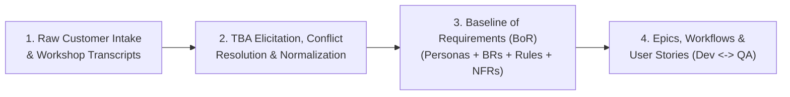

# TBA Role Governance Standard: Baseline of Requirements (BoR) Specification

**Artifact Type**: Universal Technical Business Analyst (TBA) Role Standard  
**Artifact ID**: `TBA-STD-BOR`  
**Version**: `1.0.0`  
**Applicable Scope**: All Software & Business Transformation Initiatives (Domain-Agnostic)  

---

## 1. Purpose of the Baseline of Requirements (BoR) in the TBA Role

In the **Technical Business Analyst (TBA)** methodology, the **Baseline of Requirements (BoR)** (also known as the *Book of Requirements*) is the single, authoritative catalog of business needs, domain rules, actor personas, and non-functional constraints synthesized from:
1. **Initial Customer Intake Documents** (Project charters, business wishlists, UX concepts, security questionnaires).
2. **Stakeholder Discovery Workshop Transcripts** (Structured interviews where ambiguities, edge cases, and conflicting stakeholder requests are resolved).

The BoR serves as the **upstream foundation** from which all downstream delivery artifacts—Epics (`EPIC-xx`), Process Workflows, User Stories (`US-xxx`), and QA Test Cases (`TC-xxx`)—are derived and traced.

---

## 2. Mandatory Structure of a TBA Baseline of Requirements (BoR)

Whenever a Technical Business Analyst produces or evaluates a **Baseline of Requirements (BoR)** for any application, it must contain the following five standardized sections:

### Section 2.1: Document Control & Stakeholder Sign-Off Matrix
- **Version & Baseline Date**: Semantic version (`1.0.0`) and date of formal baseline lock.
- **Source Artifacts Inventory**: Explicit references to all intake documents and workshop transcripts analyzed.
- **Stakeholder Sign-Off Roster**: Names and roles of the Business Sponsor, Domain Power Users, UX Lead, Security/Compliance Architect, Development Lead, and QA Manager.

### Section 2.2: Catalog of Actor Personas (`PER-01` .. `PER-NN`)
Every distinct human or system actor interacting with the solution must be cataloged with:
- **`Persona ID`**: Standardized identifier (`PER-01`, `PER-02`, ...).
- **`Role / Title`**: Canonical persona name used across all User Stories (`As a <Persona Name>...`).
- **`Access & Permission Tier`**: Authorization boundary (e.g., Standard User, Editor/Contributor, Administrator/Owner, Read-Only Viewer, External System).
- **`Primary Business Objectives`**: What measurable outcomes this persona seeks from the system.

### Section 2.3: Baselined Functional Business Requirements (`BR-001` .. `BR-NNN`)
Every functional requirement elicited during discovery must be normalized into an atomic, uniquely numbered record containing:
- **`Requirement ID`**: `BR-001`, `BR-002`, etc.
- **`Priority (MoSCoW)`**: `Must-Have`, `Should-Have`, `Could-Have`, or `Won't-Have (Out of Scope)`.
- **`Requirement Title & Statement`**: Declarative statement written in unambiguous business and technical language (*"The system must..."*).
- **`Domain Rules & Validation Boundaries`**:
  - Exact input constraints (required vs. optional fields, character lengths, numeric ranges, allowed formats/enums, collection capacity limits).
  - Default values when optional inputs are omitted.
  - Lifecycle and state-transition rules (allowed vs. forbidden transitions and required precondition data).
  - Deletion, archival, retention, and recovery policies.
- **`Source Trace`**: Exact workshop session or customer intake document where the requirement was established.

### Section 2.4: Baselined Non-Functional Requirements (`NFR-001` .. `NFR-NNN`)
Every system-wide quality attribute and operational constraint must be quantified with testable target metrics:
- **Security & Authentication**: Credential hashing standards, token lifetimes, session management, input sanitization (XSS/injection protection), and row-level authorization (RBAC).
- **Rate Limiting & Abuse Prevention**: Requests-per-minute thresholds per user/IP and expected throttle responses (`HTTP 429`).
- **Performance & Latency SLAs**: Quantified response-time targets (e.g., `p95` latency in milliseconds for writes/mutations vs. complex search/filter queries at a specified dataset scale).
- **Reliability, Offline Resilience & Accessibility**: Optimistic UI behavior, offline queue synchronization, and accessibility compliance standard (e.g., WCAG 2.1 Level AA).
- **Compliance, Auditability & Data Privacy**: Immutable audit logging requirements, data portability (import/export formats), and regulatory data erasure timelines (e.g., GDPR).

### Section 2.5: Explicit Scope Boundaries (In-Scope vs. Out-of-Scope)
- **In-Scope for Target Release**: Capabilities committed for the current delivery phase.
- **Out-of-Scope / Deferred**: Capabilities explicitly excluded from the current release to prevent scope creep during Development and Testing.

---

## 3. TBA Conflict Resolution & Synthesis Rules

When synthesizing a BoR from multiple customer documents and workshop transcripts, the TBA must follow three core governance rules:
1. **Workshop Decisions Supersede Initial Wishlists**: If an initial customer intake memo states a vague or conflicting preference that is subsequently refined or overridden during a stakeholder discovery workshop, the **agreed workshop decision** governs the BoR (with the change noted in the trace).
2. **Zero Vague Adjectives**: Words like *"fast"*, *"short"*, *"reasonable limit"*, or *"user-friendly"* are prohibited in a baselined requirement. Every qualitative statement must be converted into a concrete boundary (e.g., `1–120 characters`, `< 100 ms p95`, `max 20 items`, `30 calendar days`).
3. **100% Downstream Traceability**: No requirement in the BoR is orphaned; every `BR-xxx` and `NFR-xxx` must map forward into at least one Epic, User Story, and QA Test Case.
