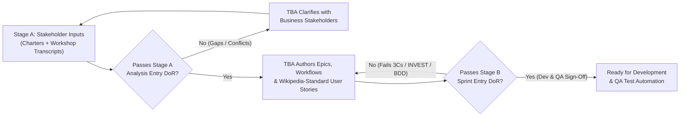

# TBA Role Governance Standard: Definition of Ready (DoR)

**Artifact Type**: Universal Technical Business Analyst (TBA) Role Standard  
**Artifact ID**: `TBA-STD-DOR`  
**Version**: `1.0.0`  
**Applicable Scope**: All Technical Business Analysis & Agile Delivery Workflows (Domain-Agnostic)  

---

## 1. Purpose of the Definition of Ready (DoR) for the TBA Role

In an agile engineering organization, the **Technical Business Analyst (TBA)** sits at the critical intersection between **Business Stakeholders**, the **Development Team**, and the **Testing (QA) Team**.

The **Definition of Ready (DoR)** establishes the mandatory **Entry Quality Gates** at two stages of the TBA's workflow:
- **Stage A — TBA Analysis Entry Gate**: Criteria that raw stakeholder inputs must satisfy before the TBA can lock a **Baseline of Requirements (BoR)**.
- **Stage B — Sprint Handshake Entry Gate (Dev ↔ QA Interface)**: Criteria that every TBA-authored **Epic, Workflow, and User Story** must satisfy before the Development and Testing teams accept it into a delivery sprint.

---

## 2. Stage A: TBA Analysis Entry Gate (Readiness to Baseline Requirements)

Before a Technical Business Analyst marks requirements discovery complete and locks the **Baseline of Requirements (BoR)**, the following intake conditions must be met:
- [ ] **Business Objectives & KPIs Defined**: The business problem, value proposition, and measurable target metrics are documented.
- [ ] **Stakeholder Perspectives Represented**: Input has been collected across Business Sponsorship, Daily Operations / End Users, UX / Product Design, and Security / Compliance.
- [ ] **User Personas Identified**: All distinct actor roles and permission tiers interacting with the system are clearly distinguished.
- [ ] **Ambiguities & Edge Cases Probed**: High-level customer wishes have been probed through discovery workshops to establish exact boundary numbers, state transitions, error handling, and lifecycle rules.
- [ ] **Scope Boundaries Agreed**: In-Scope MVP deliverables versus Out-of-Scope deferred items are explicitly agreed by the Product Sponsor.

---

## 3. Stage B: Sprint Handshake Entry Gate (User Story & Delivery Artifact DoR)

Because the **User Story** is the binding contract between the **Development Team** (who build the system) and the **Testing Team** (who verify the system), no User Story (`US-xxx`) is considered **Ready** for sprint execution unless it complies with all five readiness gates below:

### Gate 1: "The Card" & Traceability Readiness
- [ ] **Unique Story ID & Parent Epic Link**: Story carries a unique identifier (`US-xxx`) and links to a defined parent Epic (`EPIC-xx`).
- [ ] **Upstream BoR Traceability**: Story explicitly references the baselined Business Requirement(s) (`BR-xxx`) and Non-Functional Requirement(s) (`NFR-xxx`) it fulfills.
- [ ] **Canonical Connextra Template**: The story summary is written in the standard role-feature-benefit structure:
  > *"As a `<Persona / Role>`, I want `<capability / action>`, so that `<business benefit / measurable value>`."*
- [ ] **Priority & Effort Estimate**: Story has an assigned MoSCoW priority (`Must-Have`, `Should-Have`, `Could-Have`) and a Fibonacci Story Point size (`1, 2, 3, 5, 8`). Stories exceeding `8` points must be decomposed into smaller stories.

---

### Gate 2: "The Conversation" — Development Team Interface Readiness
The **Conversation** section of the User Story must eliminate all guesswork for Software Engineers by specifying:
- [ ] **Data Model & Validation Rules**: Every relevant entity attribute, data type, required/optional flag, default value, character/numeric range, regex pattern, and collection capacity limit.
- [ ] **State Machine & Business Logic Invariants**:
  - Valid states and allowed transitions (`State A -> State B`).
  - Explicitly forbidden transitions (`State B -> State C` blocked) and required precondition data.
  - Automated side effects (timestamps set/cleared, child entity cascades, notification triggers, audit log entries).
- [ ] **API / Interface & Error Contract**: Expected input payload, output response structure, and deterministic error codes (`HTTP 400`, `403`, `404`, `409`, `422`, `429`) with domain error identifiers.
- [ ] **Security & Authorization Rules**: Role-based permission checks (`OWNER`, `EDITOR`, `VIEWER`, tenant isolation) and input sanitization requirements.

---

### Gate 3: "The Confirmation" — Testing (QA) Team Interface Readiness
The **Confirmation (Acceptance Criteria)** section of the User Story must enable QA Engineers to design and automate test cases directly from the story without consulting external undocumented knowledge:
- [ ] **Strict BDD Gherkin Syntax (`Given / When / Then`)**: Every acceptance criterion is expressed as:
  > **`Given`** `<initial context / system state / actor role>`, **`When`** `<trigger action / input event>`, **`Then`** `<verifiable system state change / output / error response>`.
- [ ] **Assigned QA Test Case IDs (`TC-xxx-01`, `TC-xxx-02`, ...)**: Every BDD scenario has a unique Test Case identifier for end-to-end Requirements Traceability Matrix (`RTM`) tracking.
- [ ] **Mandatory 3-Vector Scenario Coverage**:
  1. **Happy Path Scenarios**: Normal, valid end-to-end execution.
  2. **Boundary & Edge-Case Scenarios**: Exact min/max limits (`N` vs `N+1`), date/time rollovers, empty states, and concurrency/idempotency edges.
  3. **Negative, Guardrail & Security Scenarios**: Invalid inputs, forbidden state transitions, and unauthorized role access attempts.

---

### Gate 4: Bill Wake's INVEST Quality Audit
Every User Story must pass all six **INVEST** criteria before entering the sprint:

| INVEST Dimension | Mandatory Readiness Verification Question |
| :--- | :--- |
| **I — Independent** | Is the story self-contained, with no circular dependencies blocking independent development and testing? |
| **N — Negotiable** | Does the story define clear functional & quality contracts while leaving internal implementation mechanics clean? |
| **V — Valuable** | Does the story deliver observable value to an identified user persona or business stakeholder? |
| **E — Estimable** | Are all business rules, edge cases, and acceptance criteria concrete enough for Dev and QA to size confidently? |
| **S — Small** | Is the story scoped small enough (`<= 8 Story Points`) to be coded, reviewed, and verified within a single sprint? |
| **T — Testable** | Does every acceptance criterion produce an objective, binary Pass/Fail result when executed by QA? |

---

### Gate 5: Supporting Workflow & Delivery Documentation Readiness
- [ ] **Visual Workflow Alignment**: Multi-step processes, actor interactions, and state lifecycles referenced by the story are modeled in companion Mermaid diagrams (`flowchart`, `sequenceDiagram`, `stateDiagram-v2`).
- [ ] **Three-Amigo Alignment**: The **TBA**, **Development Lead**, and **QA Lead** have jointly reviewed the story and confirmed zero open blockers or `"TBD"` items remain.
