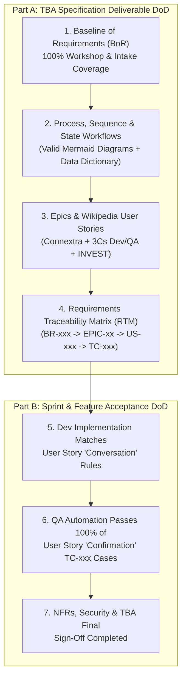

# TBA Role Governance Standard: Definition of Done (DoD)

**Artifact Type**: Universal Technical Business Analyst (TBA) Role Standard  
**Artifact ID**: `TBA-STD-DOD`  
**Version**: `1.0.0`  
**Applicable Scope**: All Technical Business Analysis Deliverables & Sprint Acceptance Gates (Domain-Agnostic)  

---

## 1. Purpose of the Definition of Done (DoD) for the TBA Role

In the **Technical Business Analyst (TBA)** lifecycle, the **Definition of Done (DoD)** governs two complementary completion gates:
1. **Part A — TBA Deliverable Package DoD**: The quality and completeness criteria that the TBA's own specification artifacts (*Baseline of Requirements*, *Epics*, *User Stories*, *Process Workflows*, *Data Dictionary*, and *Requirements Traceability Matrix*) must meet before the TBA analysis work is declared **DONE**.
2. **Part B — Feature & Sprint Acceptance DoD**: The verification criteria used by the TBA, Development Team, and Testing (QA) Team to confirm that a built User Story or Epic fulfills the specification and is **DONE**.

---

## 2. Part A: Definition of Done for TBA Specification Deliverables

A Technical Business Analyst's specification package is **DONE** only when all four core deliverable categories satisfy every check below:

### 2.1 Baseline of Requirements (BoR) DoD
- [ ] **100% Discovery Coverage**: Every business goal, persona, functional rule, boundary condition, edge case, and non-functional requirement raised across all customer submissions and workshop transcripts is captured.
- [ ] **Conflict Resolution Documented**: Any discrepancies between early stakeholder wishlists and final workshop decisions are reconciled into a single authoritative baseline.
- [ ] **Atomic & Quantified**: Every Functional Requirement (`BR-xxx`) and Non-Functional Requirement (`NFR-xxx`) is uniquely numbered, assigned a MoSCoW priority, and free of ambiguous or unquantified language.

### 2.2 Process Workflows & Technical Delivery Specifications DoD
- [ ] **End-to-End Business Process Flowcharts (`flowchart TD` / `LR`)**: Every core business workflow, decision gate, approval threshold, and error branch is visually modeled in valid Mermaid syntax.
- [ ] **Actor & System Sequence Diagrams (`sequenceDiagram`)**: Interactions across user roles, application interfaces, backend engines, and audit/notification services are modeled step-by-step.
- [ ] **Entity Lifecycle State Diagrams (`stateDiagram-v2`)**: All valid states, allowed transitions, guard conditions, and forbidden transitions are explicitly diagrammed.
- [ ] **Data Dictionary & Interface Contracts**: All domain entities, field names, data types, validation constraints, default values, and error codes are tabulated for the Development and QA teams.

### 2.3 Epics & User Stories (Dev ↔ QA Interface Contract) DoD
Every Epic (`EPIC-xx`) and User Story (`US-xxx`) authored by the TBA must include all required User Story & Acceptance Criteria elements:
- [ ] **Epic Decomposition**: High-level initiatives are grouped into logical Epics (`EPIC-01`..`EPIC-NN`) with clear business objectives, scope boundaries, and success metrics.
- [ ] **The Card (Connextra Format & Metadata)**:
  - Every story includes a valid Connextra statement (`"As a <role>, I want <goal>, so that <benefit>"`).
  - Includes `Story ID`, `Parent Epic ID`, `Source BR ID(s)`, `MoSCoW Priority`, `Fibonacci Story Points`, and `Dependencies`.
- [ ] **The Conversation (Development Team Specification)**:
  - Provides complete, unambiguous implementation logic: field validations, state transition rules, side effects, security/RBAC checks, and API error codes.
- [ ] **The Confirmation (Testing Team BDD Specification)**:
  - Provides complete, numbered QA Test Cases (`TC-xxx-01`, `TC-xxx-02`, ...) written in strict **`Given / When / Then`** BDD Gherkin format.
  - Covers **Happy Path**, **Exact Boundary / Edge Cases**, and **Negative / Error / Security Cases** for every story.
- [ ] **Bill Wake's INVEST Audit**:
  - Every story includes an explicit **INVEST** verification confirming it is *Independent, Negotiable, Valuable, Estimable, Small, and Testable*.

### 2.4 Requirements Traceability Matrix (RTM) DoD
- [ ] **Bidirectional Traceability (Zero Orphans)**: A complete Requirements Traceability Matrix (`RTM`) table maps:
  $$\text{Source (Workshop / Intake)} \longrightarrow \text{Business Req (BR / NFR)} \longrightarrow \text{Epic (EPIC-xx)} \longrightarrow \text{User Story (US-xxx)} \longrightarrow \text{QA Test Cases (TC-xxx)}$$
- [ ] **100% Forward & Backward Coverage**:
  - Every baselined `BR-xxx` and `NFR-xxx` is covered by at least one `US-xxx` and one `TC-xxx`.
  - No `US-xxx` exists without tracing back to a valid business requirement (preventing gold-plating).

---

## 3. Part B: Definition of Done for Sprint & Feature Acceptance (Dev + QA + TBA)

When the Development and Testing teams execute the TBA's User Stories during delivery sprints, a User Story or Epic is accepted as **DONE** by the TBA only when:

1. **Development Contract Fulfilled ("The Conversation")**:
   - [ ] All functional rules, defaults, validation limits, state guards, and error codes specified in the User Story's **Conversation** are implemented and peer-reviewed.
   - [ ] All state mutations write the required immutable audit trail records.
2. **Testing Contract Fulfilled ("The Confirmation")**:
   - [ ] **100% of mapped `TC-xxx` BDD scenarios** in the User Story's **Confirmation** pass in automated unit, integration, and end-to-end test suites.
   - [ ] Boundary and negative test cases confirm that forbidden transitions, invalid payloads, and unauthorized role requests are rejected with the exact specified error codes.
3. **Non-Functional & Security Compliance (`NFRs`)**:
   - [ ] Input sanitization (XSS/injection protection), authentication, rate limiting, and role-based access control (RBAC) pass security verification.
   - [ ] Latency SLAs, accessibility requirements (WCAG 2.1 AA), and data portability rules meet the baselined NFR thresholds.
4. **TBA & Product Owner Acceptance Sign-Off**:
   - [ ] The TBA verifies the delivered behavior against the **Requirements Traceability Matrix (RTM)** and records formal acceptance sign-off.
